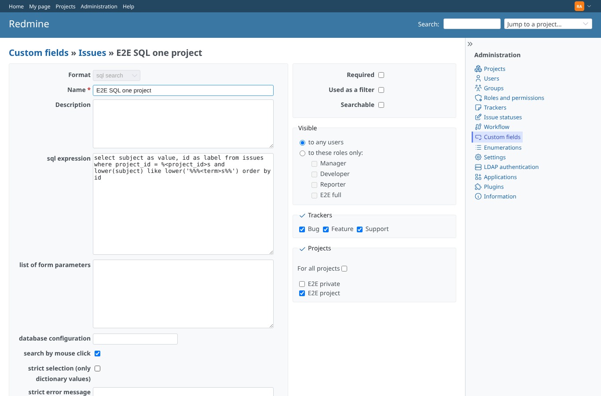
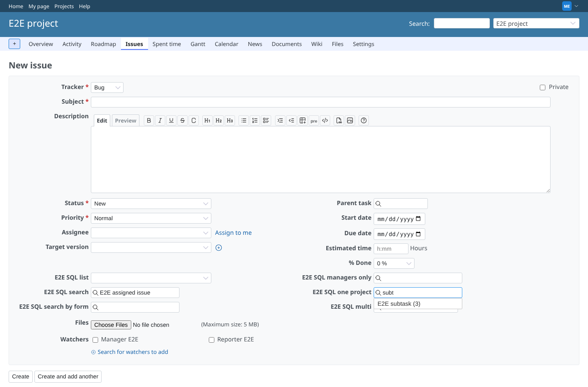
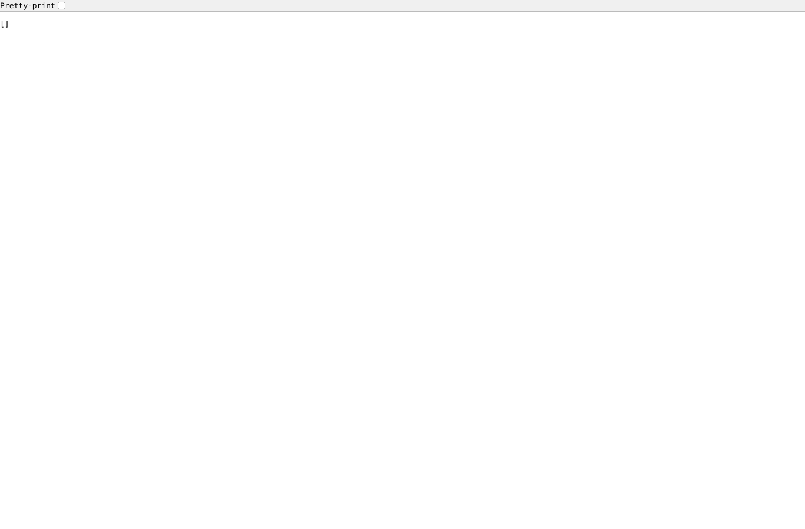
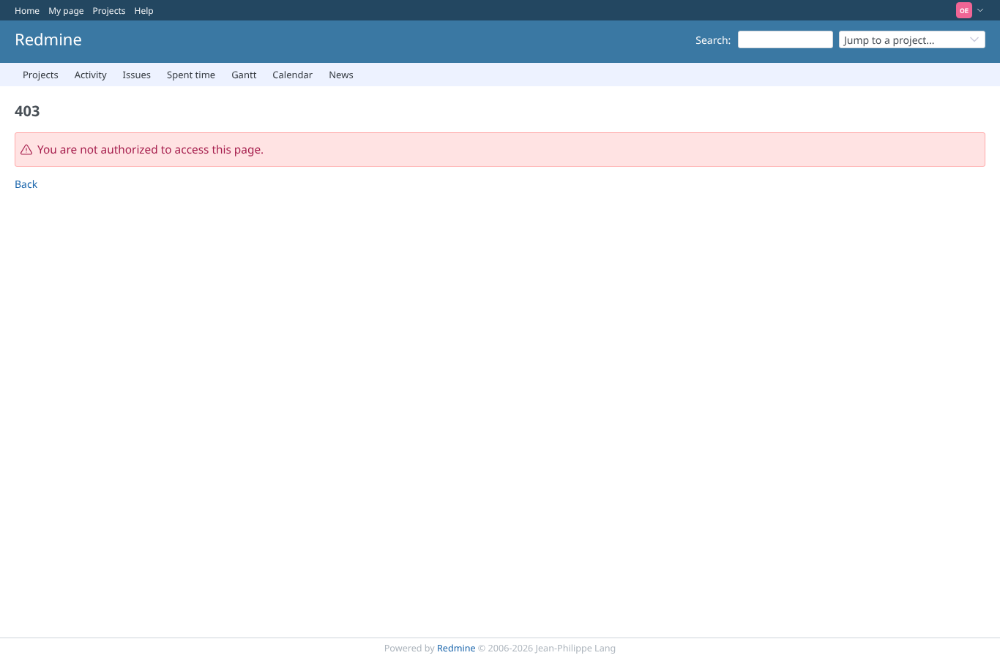

# legacy_placeholder

Run 2026-10-14T22:37:16.316Z against http://127.0.0.1:3000.

| screenshot | user | URL | shows |
|---|---|---|---|
|  | admin | `/custom_fields/5/edit` | Administration: E2E SQL one project saved with the legacy placeholders %<project_id>s and %<term>s |
|  | manager | `/projects/e2e-project/issues/new` | Manager, new issue form: typing "subt" in E2E SQL one project (legacy SQL) lists E2E subtask (3) |
|  | manager | `/custom_sql_search/search?project_id=e2e-project&custom_field_id=5&term=zzz%27)%20or%201%3D1%20or%20lower(subject)%20like%20lower(%27` | Injection through the term into the legacy %<term>s: HTTP 200, 0 rows |
|  | outsider | `/custom_sql_search/search?project_id=e2e-private&custom_field_id=5&term=e2e` | Outsider on private e2e-private: still refused (HTTP 403); the legacy form changes nothing in the checks |
